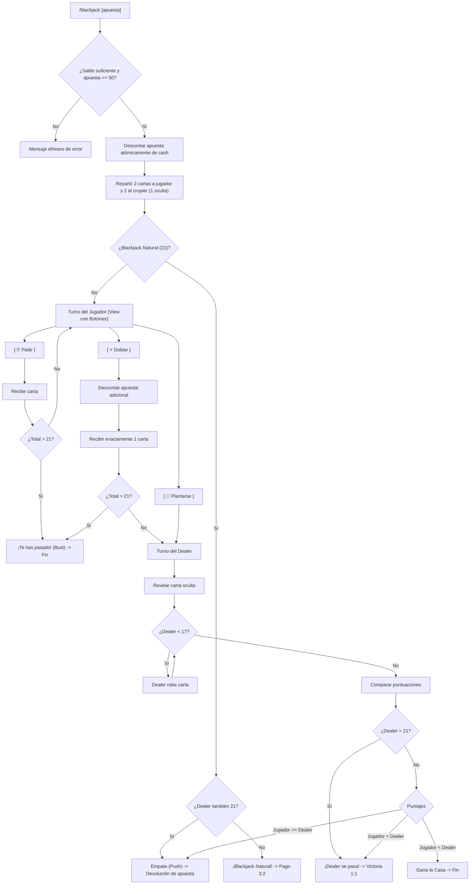

# Especificación de Diseño: Blackjack 21 Nativo (`/blackjack`)

> **Ámbito**: Sistema de Casino Nativo de Discord (`Economia Asistente`).  
> **Estado**: `[Aprobado · Jose · 19/10/2026]`  
> **Referencia de Arquitectura**: Regla Global §13 (Documentación Viva).  

---

## 1. Visión y Objetivos

El objetivo de este módulo es dotar al servidor de una experiencia de **Blackjack 21** interactiva, visual y de alta fidelidad para el bot `Economia Asistente`, eliminando la dependencia del comando clásico `!bj` de UnbelievaBoat.

Se aprovechan los componentes interactivos nativos de Discord (`discord.ui.View` y `discord.ui.Button`) para permitir una interacción rápida mediante clics sin necesidad de teclear comandos continuos.

---

## 2. Reglas del Juego y Parámetros Matemáticos

| Parámetro | Valor Oficial | Explicación Técnica |
| :--- | :--- | :--- |
| **Zapato / Barajas** | 6 barajas (312 cartas) | Estándar de casino internacional. Se rebaraja automáticamente cuando quedan menos de 52 cartas. |
| **Puntaje de Ases** | Flexible (1 u 11) | Se evalúan dinámicamente: 11 si no causa pasarse de 21 (*Bust*), o 1 en caso contrario. |
| **Regla del Dealer (Casa)** | Se planta en $\ge 17$ | El crupier debe pedir con 16 o menos y plantarse obligatoriamente con 17 o más (*Dealer stands on all 17s*). |
| **Pago Blackjack Natural** | **3:2** ($1.5\times$ ganancia neta) | As + carta de 10 de inicio. Retorna la apuesta $+ 1.5\times$ apuesta (total $2.5\times$). |
| **Pago Victoria Regular** | **1:1** ($1.0\times$ ganancia neta) | Jugador supera al dealer o dealer se pasa. Retorna la apuesta $+ 1.0\times$ apuesta (total $2.0\times$). |
| **Empate (Push)** | **0:0** (Devolución íntegra) | Mismo puntaje. Se devuelve el $100\%$ de la apuesta al jugador. |
| **Derrota / Jugador Bust** | Pérdida de la apuesta | Jugador supera 21 o dealer tiene mayor puntaje sin pasarse. |
| **Doblar (*Double Down*)** | Permitido en turno 1 | Disponible solo con las 2 primeras cartas. Duplica la apuesta, recibe exactamente 1 carta más y se planta de inmediato. |
| **Alimentación del Jackpot**| 3% de pérdidas netas | Las pérdidas netas alimentan el `server_jackpot` progresivo de [`datos/economia.json`](file:///c:/Users/jose/OneDrive/Antigravity-general/Antigravity-discord/datos/economia.json). |

---

## 3. Representación Visual de las Cartas

Para una inmersión visual atractiva sin saturar texto:
* **Palos**: Picas (`♠️`), Corazones (`♥️`), Rombos (`♦️`), Tréboles (`♣️`).
* **Valores**: `A`, `2`, `3`, `4`, `5`, `6`, `7`, `8`, `9`, `10`, `J`, `Q`, `K`.
* **Carta Oculta del Dealer**: Mostrada como `🂠 [Carta Oculta]` durante el turno del jugador para mantener la tensión dramática del casino.
* **Formato en Embed**:
  * Crupier: `[ 🂠 ? ] [ K♠️ ]` $\to$ Puntaje visible: `10 + ?`.
  * Jugador: `[ A♣️ ] [ 8♥️ ]` $\to$ Puntaje: `19 (Soft)`.

---

## 4. Componentes Interactivos y Flujo de Juego

### Controles de la Interfaz (`BlackjackView`):
1. **`[ 🃏 Pedir ]`** (`ButtonStyle.primary`): Añade una carta a la mano del jugador.
2. **`[ 🛑 Plantarse ]`** (`ButtonStyle.danger`): Finaliza el turno del jugador y activa la resolución del crupier.
3. **`[ ⚡ Doblar ]`** (`ButtonStyle.success`): Duplica la apuesta (si el jugador tiene suficiente saldo en `cash`), añade 1 carta final y procede al crupier. Deshabilitado si el jugador no tiene saldo o tras pedir la primera carta.
4. **Timeout de Seguridad**: 60 segundos de inactividad provocan que el jugador se plante automáticamente (`auto-stand`) para no congelar su apuesta ni la sesión.
5. **Control de Concurrencia**: Máximo 1 partida activa por usuario simultáneamente (`ACTIVE_BLACKJACK_GAMES`).

---

## 5. Integración con el Bot `Economia Asistente`

* **Comandos Registrados**:
  * `/blackjack apuesta:<int|all>` (Comando principal).
  * `/bj apuesta:<int|all>` (Alias rápido por ergonomía).
* **Ubicación en el Runner Dual**: Incorporados en `ECONOMY_SLASH_COMMANDS` dentro de [`modulos/comandos.py`](file:///c:/Users/jose/OneDrive/Antigravity-general/Antigravity-discord/modulos/comandos.py), manteniendo aislados los comandos generales de `Asistente`.
* **Persistencia Atómica**: Uso estricto de `ECONOMY_LOCK`, `modify_balance`, y `safe_write_json` de [`modulos/economia.py`](file:///c:/Users/jose/OneDrive/Antigravity-general/Antigravity-discord/modulos/economia.py).
